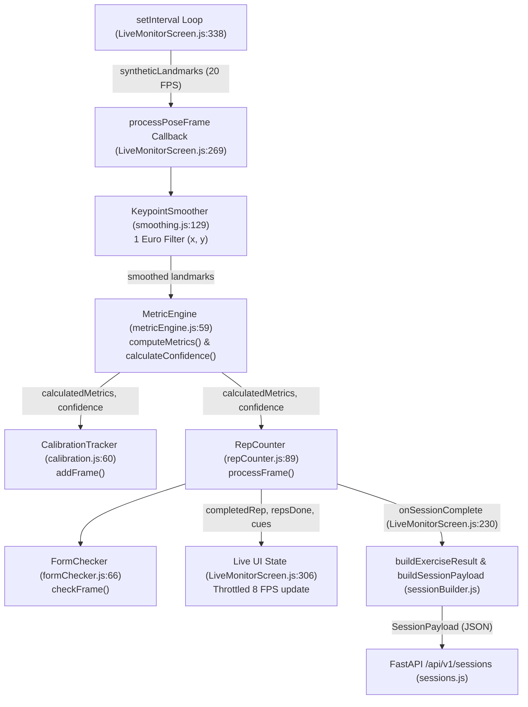
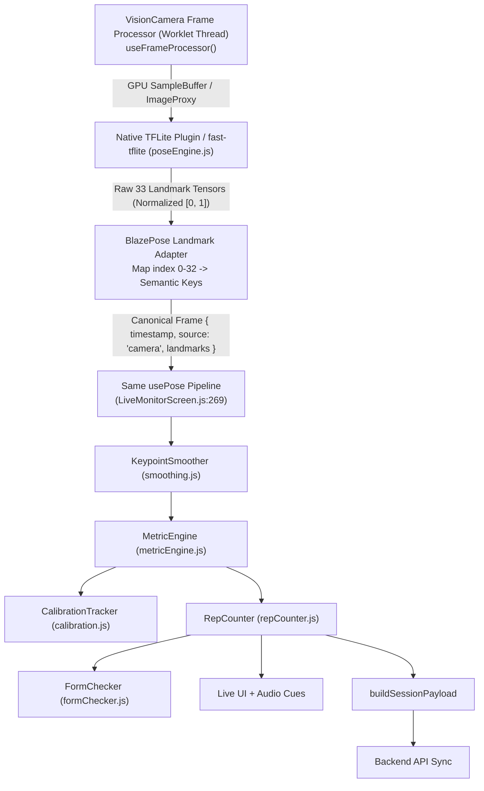

# 03. Data Flow Analysis & Module Input Contracts

**Date:** 2026-11-07  
**Project:** AxioMedica / RehabStep AI  
**Goal:** Map the end-to-end data pipeline from frame acquisition through kinematics to API submission, proving exact module dependencies to prevent downstream regressions.

---

## 1. Architecture Flow Diagrams

### Current Flow (Simulated / Synthetic)


### Target Flow (Real VisionCamera + MediaPipe/TFLite BlazePose)


---

## 2. Processing Module Deep-Dive & Input Assumptions

### 1. `MetricEngine` (`mobile/src/pose/metricEngine.js`)

* **Role:** Computes declared kinematic metrics (angles in degrees, vertical deltas, limb distances) and aggregate confidence from landmarks.
* **Input Fields Read:**
  - Semantic landmark objects retrieved via `resolveLandmark(jointName, landmarks)` ([metricEngine.js:32-50](file:///c:/c_backup/projects/AxioMedica/mobile/src/pose/metricEngine.js#L32-L50)):
    - `pt.x` (number, normalized 0.0 to 1.0)
    - `pt.y` (number, normalized 0.0 to 1.0)
    - `pt.visibility` (number, 0.0 to 1.0) for `calculateConfidence()` ([metricEngine.js:106-128](file:///c:/c_backup/projects/AxioMedica/mobile/src/pose/metricEngine.js#L106-L128))
* **Coordinate Assumption:**
  - **Normalized Coordinates [0, 1]** with origin `(0, 0)` at **top-left** ([geometry.js:6-7](file:///c:/c_backup/projects/AxioMedica/mobile/src/pose/geometry.js#L6-L7)).
  - Vertical delta formula: `reference.y - target.y` ([geometry.js:51-54](file:///c:/c_backup/projects/AxioMedica/mobile/src/pose/geometry.js#L51-L54)). A target higher on screen than reference produces a positive delta.
* **Missing Landmark Behavior:**
  - `resolveLandmark()` returns `null` if the landmark is absent.
  - In `geometry.js`:
    - `angle(a, b, c)`: `if (!a || !b || !c) return 0;` ([geometry.js:21](file:///c:/c_backup/projects/AxioMedica/mobile/src/pose/geometry.js#L21))
    - `verticalDelta(target, ref)`: `if (!target || !reference) return 0;` ([geometry.js:52](file:///c:/c_backup/projects/AxioMedica/mobile/src/pose/geometry.js#L52))
    - `distance(a, b)`: `if (!a || !b) return 0;` ([geometry.js:64](file:///c:/c_backup/projects/AxioMedica/mobile/src/pose/geometry.js#L64))
  - Does **not** throw; returns `0` gracefully.
* **Output Shape:**
  ```javascript
  // computeMetrics(landmarks)
  {
    heel_height: 0.082,         // vertical_delta (normalized units)
    ankle_angle: 88.4,          // degrees [0, 180]
    hip_vertical_delta: 0.012,  // vertical_delta (normalized units)
    rep_duration_ms: 1420       // optional context metric
  }

  // calculateConfidence(landmarks) -> number (0.0 to 1.0)
  ```

---

### 2. `RepCounter` (`mobile/src/pose/repCounter.js`)

* **Role:** Hysteresis state machine driven by `pose_config.phases` and `pose_config.rep_cycle`. Enforces minimum rep duration and tracks peak ROM excursion.
* **Input Fields Read:**
  - `metrics` object from `MetricEngine.computeMetrics()`:
    - Primary angular metric value (e.g. `metrics.ankle_angle` or `metrics.heel_height`)
    - Phase threshold conditions (e.g., `metrics.heel_height >= 0.08`)
  - `confidence` score (number, 0.0 to 1.0)
  - `timestamp` (integer ms, default `Date.now()`)
* **Coordinate Assumption:**
  - Agnostic to raw coordinates; operates strictly on computed metric units (degrees for angles, normalized deltas for vertical excursions, ms for time).
* **Missing Landmark / Metric Behavior:**
  - If a metric is `NaN` or `undefined`, `evaluateCondition()` returns `false` ([formChecker.js:16-19](file:///c:/c_backup/projects/AxioMedica/mobile/src/pose/formChecker.js#L16-L19)).
  - The state machine stays in its current phase until valid metric values trigger the transition.
* **Output Shape:**
  ```javascript
  // processFrame(metrics, confidence, timestamp)
  {
    repCompleted: false,        // boolean
    repsDone: 4,                // integer
    currentPhase: "up",         // string phase name
    completedRep: null,         // or RepResult object on rep boundary:
    /*
    completedRep: {
      set_no: 1,
      rep_no: 5,
      duration_ms: 2150,
      rom_deg: 38.5,
      form_score: 90,
      errors: ["low_height"],
      confidence: 0.94
    }
    */
    cues: ["Rise higher onto the ball of your foot — push through the big toe."]
  }
  ```

---

### 3. `FormChecker` (`mobile/src/pose/formChecker.js`)

* **Role:** Safe rule evaluator evaluating `pose_config.form_rules` without `eval()`. Calculates deductions and generates real-time audio/visual cues.
* **Input Fields Read:**
  - `metrics` dictionary (`metrics[condition.metric]`)
  - Configured rules with operators: `'lt'`, `'lte'`, `'gt'`, `'gte'`, `'between'`
* **Coordinate Assumption:**
  - Metric space: angles (degrees), durations (ms), normalized vertical deltas (`0.0 - 1.0`).
* **Missing Landmark / Metric Behavior:**
  - `evaluateCondition()`: `if (!condition || !metrics) return false;`
  - `if (typeof val !== 'number' || isNaN(val)) return false;` ([formChecker.js:17-19](file:///c:/c_backup/projects/AxioMedica/mobile/src/pose/formChecker.js#L17-L19))
  - Never crashes on missing values; rule simply does not fire.
* **Output Shape:**
  ```javascript
  // checkFrame(metrics)
  {
    newlyFired: ["too_fast"],
    cues: ["Slow down — aim for 2 seconds up, hold, then 2 seconds down."]
  }

  // finalizeRep()
  {
    errors: ["too_fast"],
    score: 90 // 100 - (10 * errorCount), clamped >= 0
  }
  ```

---

### 4. `CalibrationTracker` (`mobile/src/pose/calibration.js`)

* **Role:** Collects initial neutral posture frames (minimum 10-15 frames) to establish personalized baseline Range of Motion (ROM) and neutral joint angles.
* **Input Fields Read:**
  - `metrics`: map of computed metrics (e.g., `metrics.ankle_angle`, `metrics.heel_height`)
  - `confidence`: frame confidence score (`0.0 - 1.0`)
* **Coordinate Assumption:**
  - Metric space: degrees for joint angles, normalized deltas.
* **Missing Landmark / Metric Behavior:**
  - Ignores `NaN` or non-numeric metric values ([calibration.js:65-69](file:///c:/c_backup/projects/AxioMedica/mobile/src/pose/calibration.js#L65-L69)).
* **Output Shape:**
  ```javascript
  // finalize() or getBaseline()
  {
    isCalibrated: true,
    baselineRomDeg: 42.0,
    neutralAngleDeg: 89.5,
    neutralAngles: {
      ankle_angle: 89.5,
      heel_height: 0.01
    },
    minAngleDeg: 78.0,
    maxAngleDeg: 120.0,
    meanConfidence: 0.94,
    sampleCount: 15,
    calibratedAt: "2026-11-07T14:10:00.000Z"
  }
  ```

---

## 3. Summary Input Assumptions Table

| Module | Consumes | Mandatory Landmark Fields | Coordinate System | Missing Landmark Behavior | Output Type |
| :--- | :--- | :--- | :--- | :--- | :--- |
| **`KeypointSmoother`** | Raw frame landmarks map | `x: number`, `y: number` | Normalized `[0, 1]` | Preserves raw point as-is without filtering | Smoothed landmark map |
| **`MetricEngine`** | Smoothed landmarks map | `x: number`, `y: number`, `visibility: number` | Normalized `[0, 1]`, Origin top-left | Returns `0` for missing joints; skips in confidence | `Record<string, number>` metrics + confidence float |
| **`CalibrationTracker`**| Computed metrics map | Metric names from `pose_config` | Degrees / normalized delta | Ignores non-numeric / missing metrics | Calibration baseline profile |
| **`RepCounter`** | Computed metrics map + confidence | Primary metric (e.g. `ankle_angle`, `heel_height`) | Metric space | Ignores frame; does not transition phase | Rep status, completed rep telemetry, coaching cues |
| **`FormChecker`** | Computed metrics map | Declared `rule.check.metric` names | Metric space | Rule evaluation returns `false` | Newly fired rule IDs, cue strings, form score |
| **`SkeletonOverlay`** | Smoothed landmarks map | `x: number`, `y: number`, `visibility?: number` | Normalized `[0, 1]` | Skips points with `visibility <= 0.4` or missing | Rendered React Native Views |

