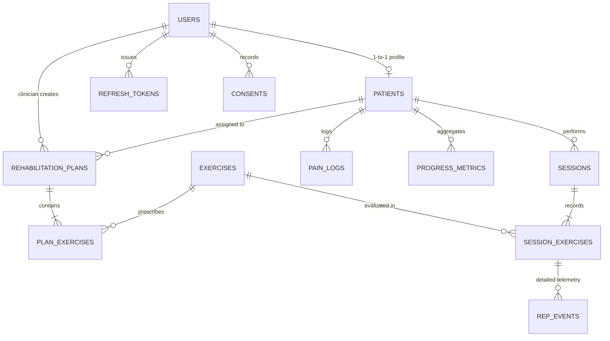

# 05. Backend API Specification & Database Contract

**Date:** 2026-11-07  
**Project:** AxioMedica Tele-Rehab Backend  
**OpenAPI Source:** [`docs/step1/openapi.json`](file:///c:/c_backup/projects/AxioMedica/docs/step1/openapi.json)

---

## 1. Endpoint Inventory & Action Roadmap

| Method | Path | Auth / Role | Current Status | Designated Action / Target Step |
| :--- | :--- | :--- | :--- | :--- |
| **GET** | `/health` | Public | 200 (healthy) / 503 (DB down) | Operational root liveness/readiness check. |
| **GET** | `/api/v1/health` | Public | 200 / 503 | Live PostgreSQL round-trip latency check. |
| **POST** | `/api/v1/auth/register` | Public | 201 Created | Creates `User`, `Patient`, camera/data consent. |
| **POST** | `/api/v1/auth/login` | Public | 200 OK | Authenticates user; returns access + refresh JWTs. |
| **POST** | `/api/v1/auth/refresh` | Refresh Bearer | 200 OK | Refresh token rotation with reuse detection. |
| **POST** | `/api/v1/auth/logout` | Refresh Bearer | 204 No Content | Revokes active refresh token. |
| **GET** | `/api/v1/auth/me` | Bearer (Any) | 200 OK | Returns current profile and role. |
| **GET** | `/api/v1/patients/me` | Bearer (Patient) | 200 OK | Extended patient profile. |
| **PATCH**| `/api/v1/patients/me` | Bearer (Patient) | 200 OK | Update phone, bio, injured ankle side. |
| **GET** | `/api/v1/plans/my-plan` | Bearer (Patient) | 200 OK | Active prescribed plan with exercises. |
| **GET** | `/api/v1/exercises` | Bearer (Any) | 200 OK | Exercise catalog with `pose_config` JSONB. |
| **GET** | `/api/v1/exercises/{id}`| Bearer (Any) | 200 OK | Exercise details by ID. |
| **POST** | `/api/v1/sessions` | Bearer (Patient) | 201 Created | **Primary Sync:** Idempotent session ingestion (`client_uuid`). |
| **GET** | `/api/v1/sessions` | Bearer (Patient) | 200 OK | Session history list with rep telemetry. |
| **GET** | `/api/v1/sessions/{id}` | Bearer (Patient) | 200 OK | Single session details with exercises/reps. |
| **GET** | `/api/v1/progress/summary`| Bearer (Patient) | 200 OK | **Action:** Remove hardcoded fallback metrics (e.g. 12 sessions, 86 reps, 94% safe range) in **Step 4**. |
| **GET** | `/api/v1/progress/metrics`| Bearer (Patient) | 200 OK | Time-series query by metric type. |
| **POST** | `/api/v1/pain-logs` | Bearer (Patient) | 201 Created | Standalone NRS pain log recording. |
| **GET** | `/api/v1/pain-logs` | Bearer (Patient) | 200 OK | Pain log history list. |
| **POST** | `/api/v1/tts` | Public / Bearer | 200 OK (WAV stream) | **Action:** Fix URL mismatch! `mobile/src/lib/tts.js:24` requests `${TTS_BASE_URL}/api/tts`. Update mobile to call `/api/v1/tts`. |
| **GET** | `/api/v1/ml/status` | Public | 200 OK | Returns `{ "service": "ml_serving", "status": "idle" }`. |
| **POST** | `/api/v1/ml/inference` | Bearer | **501 Not Implemented** | **Action:** Implement post-hoc form quality inference (`/predict/form-quality`) in **Step 5**. |
| **GET** | `/api/v1/clinician/patients` | Bearer (Clinician) | 200 OK | Clinician patient roster. |
| **POST** | `/api/v1/clinician/plans` | Bearer (Clinician) | 201 Created | Create / assign custom rehabilitation plan. |
| **PUT** | `/api/v1/clinician/plans/{id}`| Bearer (Clinician) | 200 OK | Update prescribed plan. |
| — | *Injury Risk / Recovery Trajectory* | — | Unimplemented | **Action:** **Defer** advanced risk models until clinical validation data exists. |

---

## 2. Database Entity Relationships (ERD)



### Table Definitions & Relationship Mechanics

1. **`users` (`backend/app/models/user.py:51`)**
   - PK: `id` (UUIDv4).
   - Columns: `email`, `hashed_password`, `full_name`, `role` (`'patient' | 'clinician' | 'admin'`), `is_active`.
2. **`patients` (`backend/app/models/user.py:116`)**
   - PK: `id` (UUIDv4).
   - FK: `user_id` -> `users.id` (1-to-1).
   - FK: `assigned_clinician_id` -> `users.id` (Many-to-1).
   - Columns: `injured_ankle` (`'left' | 'right'`), `injury_type`, `recovery_stage`, `current_week`, `total_weeks`, `recovery_percent`.
3. **`rehabilitation_plans` (`backend/app/models/session.py:70`)**
   - PK: `id` (UUIDv4).
   - FK: `patient_id` -> `patients.id`.
   - FK: `created_by` -> `users.id` (Clinician).
   - Columns: `title`, `description`, `status` (`'active' | 'completed' | 'archived'`).
4. **`exercises` (`backend/app/models/session.py:36`)**
   - PK: `id` (Integer autoincrement).
   - Columns: `code`, `name`, `pose_config` (JSONB, drives on-device kinematics).
5. **`sessions` (`backend/app/models/session.py:195`)**
   - PK: `id` (UUIDv4).
   - UK: `client_uuid` (UUIDv4 idempotency key).
   - FK: `patient_id` -> `patients.id`.
   - FK: `plan_id` -> `rehabilitation_plans.id` (optional).
   - Columns: `started_at`, `ended_at`, `overall_score`, `pose_model_ver`, `app_version`.
6. **`session_exercises` & `rep_events` (`backend/app/models/session.py:250, 310`)**
   - Stores per-exercise aggregates (`max_rom_deg`, `avg_form_score`, `pain_before`, `pain_after`) and per-rep telemetry (`duration_ms`, `rom_deg`, `form_score`, `errors` JSON array).

---

## 3. Calibration Baseline Storage Architecture

### Analysis of Current Gap
* Neither `Patient` nor `RehabilitationPlan` currently contains a dedicated column for kinematic calibration baselines.
* Currently, `progress.py:70` falls back to `baseline_rom = 28.0` or reads the first historical session in the database.
* Mobile's `CalibrationTracker` produces a rich baseline profile:
  ```json
  {
    "baselineRomDeg": 42.0,
    "neutralAngleDeg": 89.5,
    "neutralAngles": { "ankle_angle": 89.5, "heel_height": 0.01 },
    "sampleCount": 15,
    "calibratedAt": "2026-11-07T14:10:00.000Z"
  }
  ```

### Design Decision
1. **Target Location:** Add a `calibration_data: Mapped[dict | None] = mapped_column(JSON, nullable=True)` column to the `patients` table (via Alembic migration in Step 4).
2. **Ingestion Mechanism:** Transmit calibration metadata as an optional field in `SessionPayload` when a session includes an initial calibration phase.
3. **Usage:** `GET /progress/summary` reads `patient.calibration_data['baselineRomDeg']` as the canonical reference, eliminating the hardcoded `28.0` default.

