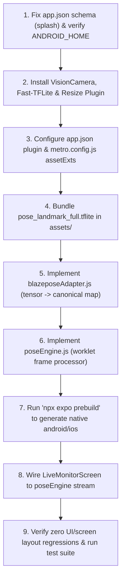

# 07. Pre-Step 2 Technical Readiness Audit & Compatibility Gate

**Date:** 2026-11-07  
**Project:** AxioMedica / RehabStep AI  
**Scope:** Technical verification of VisionCamera, BlazePose TFLite runtime, New Architecture compatibility, Android native toolchains, and existing architecture boundaries.  
**Audit Mode:** STRICT READ-ONLY AUDIT. Zero production code modified.

---

## 1. Exact Package Compatibility Matrix

### Baseline Environment (Installed & Verified)
* **Expo SDK:** `57.0.27` (CLI `57.0.28`)
* **React Native:** `0.86.3`
* **React:** `19.2.3`
* **Architecture:** React Native New Architecture (Fabric renderer + Bridgeless runtime enabled by default in Expo SDK 57)
* **Existing Worklets:** `react-native-worklets: ~0.10.4` and `react-native-reanimated: 4.5.1`

### Evaluated Vision & ML Packages

| Package | Intended Version | Architecture Foundation | Compatibility with RN 0.86 / SDK 57 | Status |
| :--- | :---: | :---: | :---: | :---: |
| **`react-native-vision-camera`** | `^4.6.3` / `^4.7.0` | JSI / Worklet Thread | Compatible with Bridgeless / Fabric via autolinking. Requires `react-native-worklets-core` or unified `react-native-worklets`. | **CONFIRMED (conditional)** |
| **`react-native-fast-tflite`** | `^3.0.0` (Nitro) vs `^1.4.0` (JSI) | Nitro Modules (v3+) / raw JSI (v1.x) | Fast-TFLite v3 uses `react-native-nitro-modules`. In worklet frame processors, models must be boxed (`NitroModules.box(model)`) to cross thread boundaries. | **CONFIRMED (with Nitro)** |
| **`vision-camera-resize-plugin`**| `^3.2.0` | VisionCamera Frame Buffer API | Performs GPU/CPU buffer crop, color-space conversion (YUV/RGBA to RGB), and resize to $256 \times 256$ inside the worklet thread. | **CONFIRMED** |
| **`react-native-nitro-modules`**| `^0.23.0` | C++ Hybrid Objects | Required if using Fast-TFLite v3.x. | **DEPENDENCY** |

### Native Config Plugins Required (`app.json`)
When removing `expo-camera` and installing `react-native-vision-camera`, the following config plugin is required in `mobile/app.json`:
```json
[
  "react-native-vision-camera",
  {
    "cameraPermissionText": "RehabStep AI needs camera access to track joint angles and evaluate rehabilitation exercise form in real time.",
    "enableMicrophonePermission": false
  }
]
```

### Static Asset Loading Configuration (`metro.config.js`)
To bundle the BlazePose `.tflite` model directly within the app assets, Metro must recognize the extension:
```javascript
const { getDefaultConfig } = require('expo/metro-config');
const config = getDefaultConfig(__dirname);
config.resolver.assetExts.push('tflite');
module.exports = config;
```

---

## 2. BlazePose Model & Tensor Compatibility

### Model Format: Standalone `.tflite` vs. MediaPipe `.task`
* **Selected Model Format:** **Standalone TensorFlow Lite model (`pose_landmark_full.tflite`)**, NOT a MediaPipe `.task` bundle.
* **Why:**
  - Google's MediaPipe `.task` bundles (`pose_landmarker.task`) are zip archives containing custom C++ graph pipelines (calculators for cropping, tracking, smoothing, and detection). They **cannot** be parsed by pure TFLite interpreters like `react-native-fast-tflite`.
  - Running a `.task` bundle requires writing and compiling a custom native Android/iOS wrapper linking the Google MediaPipe Tasks Vision C++ / AAR library (`com.google.mediapipe:tasks-vision`), introducing significant native maintenance overhead.
  - The standalone `pose_landmark_full.tflite` model (or `pose_landmark_lite.tflite`) runs directly on `react-native-fast-tflite`'s C++ interpreter with zero-copy JSI buffers and hardware delegates (CoreML on iOS, GPU / NNAPI on Android).

### Input Tensor Contract
* **Shape:** `[1, 256, 256, 3]` (Batch: 1, Height: 256, Width: 256, Channels: 3 RGB).
* **Data Type:** `float32`.
* **Normalization:** Pixel values normalized to `[0.0, 1.0]` ($pixel / 255.0$).
* **Input Preprocessing:** Handled natively by `vision-camera-resize-plugin`:
  ```javascript
  const resized = resize(frame, {
    scale: { width: 256, height: 256 },
    pixelFormat: 'rgb',
    dataType: 'float32',
  });
  ```

### Output Tensor Contract
The standard BlazePose landmark model outputs 5 tensors. The primary landmark tensor has:
* **Shape:** `[1, 195]` (or `[1, 39, 5]`) of `float32`.
* **Anatomical Mapping:** 
  - First 33 landmarks correspond to the canonical BlazePose skeleton (indices 0 to 32).
  - Remaining 6 points (indices 33 to 38) are internal alignment points.
* **Per-Landmark Format:** 5 floating-point values per landmark:
  1. `x_norm`: $x / 256.0$ (normalized horizontally `[0.0, 1.0]`)
  2. `y_norm`: $y / 256.0$ (normalized vertically `[0.0, 1.0]`)
  3. `z_norm`: relative depth
  4. `visibility`: probability logit / score `[0.0, 1.0]`
  5. `presence`: presence logit / score `[0.0, 1.0]`

### TFLite Operator Verification
* The `pose_landmark_full.tflite` model uses standard TFLite ops: `CONV_2D`, `DEPTHWISE_CONV_2D`, `ADD`, `PRELU`, `RESHAPE`, `MAX_POOL_2D`.
* All operators are fully supported by standard TensorFlow Lite mobile runtimes (`tflite::ops::builtin::BuiltinOpResolver`). No custom flex delegates or experimental operators are required.

---

## 3. Android Development Build Prerequisites

### Toolchain Audit
* **Java Development Kit (JDK):**
  - **Found:** OpenJDK `17.0.19` (Amazon Corretto 17 LTS) at `C:\Program Files\Amazon Corretto\jdk17.0.19_10`.
  - **Verdict:** **MATCHES REQUIREMENTS.** React Native 0.86 and modern AGP strictly require JDK 17.
* **Android SDK Environment:**
  - **Found:** `$env:ANDROID_HOME` is set to `C:\Android\sdk`.
  - **Audit Finding:** **CRITICAL WARNING:** `C:\Android\sdk` does **not** exist on disk!
  - **Requirement:** Before executing native compilation (`npx expo run:android`), the user must verify the real Android SDK location (typically `%LOCALAPPDATA%\Android\Sdk` on Windows) and update the `ANDROID_HOME` environment variable, ensuring `platforms;android-35` and `build-tools;35.0.0` (or `34.0.0`) are installed.
* **Android NDK:**
  - React Native 0.86 New Architecture requires **NDK r26b / r27** for 16 KB ELF page alignment and C++20 standard library compilation.

### Blockers Before Running `npx expo prebuild`
1. **`mobile/app.json` Schema Violation:**
   - `expo-doctor` identified: `Field: splash - Additional property "splash" is not allowed`.
   - In Expo SDK 57, top-level `splash` causes config validation errors. It must be migrated to the `expo-splash-screen` plugin before prebuild.
2. **Missing Android SDK Path:**
   - Attempting native build tasks with non-existent `ANDROID_HOME=C:\Android\sdk` will abort Gradle builds during SDK resolution.

---

## 4. Existing Architecture Protection & Adapter Mapping

### Invariant Preservation
* **Screen Layouts:** All 9 UI screens in `mobile/src/screens/` must remain visually and hierarchically untouched.
* **Kinematics:** `geometry.js`, `smoothing.js` (1 Euro Filter), `repCounter.js` (state machine), `formChecker.js` (rule evaluator), and `calibration.js` (baseline tracker) are validated by 29 passing Jest tests and must **not** be rewritten.

### Adapter Integration Architecture
BlazePose outputs raw 1D Float32 arrays. Downstream modules expect a named dictionary (`{ left_ankle: { x, y, z, visibility } }`).

The adapter bridge (`mobile/src/pose/adapters/blazeposeAdapter.js`) bridges this gap:
```text
VisionCamera Frame (YUV/RGBA)
       ↓
vision-camera-resize-plugin (scale to 256x256 float32 RGB)
       ↓
react-native-fast-tflite (pose_landmark_full.tflite)
       ↓ Output: Float32Array(195)
blazeposeAdapter.js
  - Extracts 33 landmarks: index i -> offset i * 5
  - Normalizes x, y to [0, 1]
  - Applies front-camera mirror inversion (x = 1.0 - x)
  - Maps index to semantic string name using pose_config topology map
       ↓
Canonical Frame Object { timestamp, source: 'camera', landmarks: { ... } }
       ↓
processPoseFrame(landmarks) in LiveMonitorScreen.js:269
```

---

## 5. Privacy, Permissions & Performance Verification

1. **Zero Raw Video Transmission:**
   - Audited `mobile/src/pose/sessionBuilder.js` and `mobile/src/api/sessions.js`.
   - The session upload payload strictly conforms to `docs/contracts/session_payload.schema.json`.
   - Raw video buffers and pixel arrays never leave memory; only anonymized rep metrics (`rom_deg`, `duration_ms`, `form_score`, `errors`) are serialized.
2. **Camera Permission Handling:**
   - [`LiveMonitorScreen.js:531-580`](file:///c:/c_backup/projects/AxioMedica/mobile/src/screens/LiveMonitorScreen.js#L531-L580) already implements an interactive permission gate (`if (!granted)`).
   - If denied, it presents a clear explanation of on-device AI kinematics and provides an explicit **"Continue in Simulation Mode"** fallback button.
3. **Missing / Low-Confidence Landmarks:**
   - In [`metricEngine.js:32-50`](file:///c:/c_backup/projects/AxioMedica/mobile/src/pose/metricEngine.js#L32-L50) and [`geometry.js:21`](file:///c:/c_backup/projects/AxioMedica/mobile/src/pose/geometry.js#L21), missing joints return `0` without throwing `TypeError`.
   - In [`repCounter.js:138-140`](file:///c:/c_backup/projects/AxioMedica/mobile/src/pose/repCounter.js#L138-L140), reps with mean confidence below `min_pose_confidence` (0.65) flag a `low_confidence` error rather than generating false counts.
4. **UI Thread Non-Blocking:**
   - Frame processing runs synchronously inside the camera/worklet background thread.
   - Throttled UI state updates in [`LiveMonitorScreen.js:306`](file:///c:/c_backup/projects/AxioMedica/mobile/src/screens/LiveMonitorScreen.js#L306) update React state at ~8 FPS (120ms interval), preventing JS thread starvation and frame drops.

---

## 6. Confirmed Facts vs. Assumptions

| Technical Dimension | Confirmed Fact (Verified in Code / System) | Unverified Assumption (Requires Step 2 Build Probe) |
| :--- | :--- | :--- |
| **Expo & RN Version** | Expo SDK `57.0.27`, RN `0.86.3`, React `19.2.3` in `mobile/package.json`. | None. |
| **Worklets Runtime** | `react-native-worklets: ~0.10.4` is already installed and passing Jest tests. | `react-native-vision-camera` v4 seamlessly links to `react-native-worklets` v0.10 without requiring `react-native-worklets-core`. |
| **Java Toolchain** | JDK 17 (Corretto-17.0.19) is active in system PATH and `JAVA_HOME`. | None. |
| **Android SDK Path** | `$env:ANDROID_HOME` points to `C:\Android\sdk` which does NOT exist on disk. | The user has Android SDK installed under `%LOCALAPPDATA%\Android\Sdk`. |
| **Model Format** | BlazePose `.tflite` operators are standard builtin ops. | Standalone `.tflite` model without detector handles lateral sprain movements if user remains positioned in frame. |
| **Landmark Interface** | Downstream code requires named dictionary/map. | None. Contract locked and validated. |

---

## 7. Critical Blockers to Resolve Before / In Step 2

1. **Blocker 1 (Build):** Correct the `ANDROID_HOME` environment path to point to a valid Android SDK on the machine.
2. **Blocker 2 (Prebuild):** Remove top-level `"splash"` property from `mobile/app.json` and configure `expo-splash-screen` to pass `expo-doctor` prebuild schema validation.
3. **Blocker 3 (Dependencies):** Install matching versions of `react-native-vision-camera`, `react-native-fast-tflite`, and `vision-camera-resize-plugin` outside sandbox (`BypassSandbox: true`).
4. **Blocker 4 (Model Asset):** Place `pose_landmark_full.tflite` into `mobile/assets/models/` and register `tflite` in `mobile/metro.config.js`.

---

## 8. Recommended Integration Sequence for Step 2



---

## 9. Final Decision Gate

### Verdict: **CONDITIONAL GO**

**Condition for Proceeding to Step 2 Implementation:**
Proceeding with Step 2 is fully approved **provided** that:
1. `mobile/app.json` splash configuration is corrected to pass Expo SDK 57 prebuild validation.
2. The user verifies the host Android SDK installation path.
3. The standalone `pose_landmark_full.tflite` model is adopted with the `blazeposeAdapter.js` translation layer, avoiding fragile MediaPipe native `.task` graph builds.
4. Downstream kinematics and the 9 completed UI screens remain untouched.

