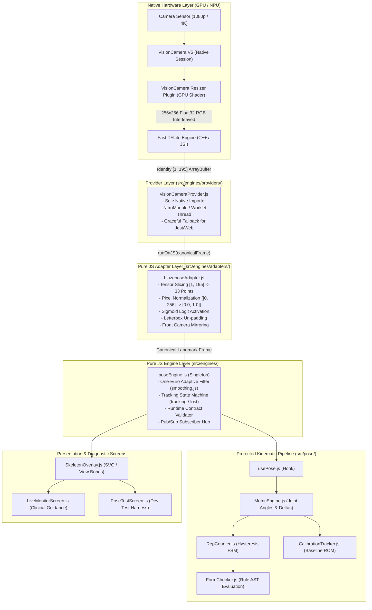

# 05. Pose Estimation Engine Architecture & Integration Guide

**Date:** 2026-11-07  
**Branch:** `step2/pose-engine`  
**Status:** COMPLETE (Step 2 Final Architectural Deliverable)  
**Authors:** Senior React Native + ML Systems Team (AxioMedica / RehabStep AI)

---

## 1. High-Level Architectural Diagram



---

## 2. Strict Layer Isolation Boundaries

| Architectural Layer | Permitted File Location | Allowed Dependencies | Invariant Rules |
| :--- | :--- | :--- | :--- |
| **Provider** | `mobile/src/engines/providers/` | `react-native-vision-camera`, `react-native-fast-tflite`, `react-native-vision-camera-resizer`, `react-native-nitro-modules`, `react-native-worklets` | **Sole native layer.** Must provide graceful fallback when native modules are absent (e.g. in Jest unit tests). Never exports raw tensors; converts frames via Adapter. |
| **Adapter** | `mobile/src/engines/adapters/` | Pure JavaScript Math | **Zero native imports.** Accepts raw tensors, decodes 33 landmarks, applies sigmoid activations, normalizes coordinates, un-pads letterboxing, and enforces the Step 1 contract. |
| **Engine** | `mobile/src/engines/` | `src/engines/adapters/`, `src/pose/smoothing.js`, `contracts/validateLandmarks.js` | **Pure JS Singleton.** Reuses `KeypointSmoother` (One Euro filter). Manages tracking state transitions (`tracking` $\leftrightarrow$ `lost`) and routes smoothed frames to subscribers. |
| **Downstream Analyzers** | `mobile/src/pose/` | `MetricEngine.js`, `RepCounter.js`, `FormChecker.js`, `CalibrationTracker.js` | **Protected (PRESERVE).** Consumes canonical smoothed landmark dictionaries. Completely agnostic of camera and TFLite runtimes. |
| **UI Components** | `mobile/src/components/`, `mobile/src/screens/` | Standard React Native components, `SkeletonOverlay.js` | Renders 2D joint nodes and skeleton bones in $[0.0, 1.0]$ coordinate space scaled to device window width/height. |

---

## 3. BlazePose Model & Tensor Specifications

### Model Files
* **Lite Variant:** `mobile/assets/models/pose_landmark_lite.tflite` (2,818,358 bytes, SHA-256: `1150dc68a713b80660b90ef46ce4e85c1c781bb88b6e3512cc64e6a685ba5588`)
* **Full Variant:** `mobile/assets/models/pose_landmark_full.tflite` (6,440,512 bytes, SHA-256: `e9a5c5cb17f736fafd4c2ec1da3b3d331d6edbe8a0d32395855aeb2cdfd64b9f`)

### Input Tensor
* **Name:** `input_1`
* **Shape:** `[1, 256, 256, 3]` (Batch: 1, Height: 256, Width: 256, Channels: 3 RGB)
* **Data Type:** `float32` (IEEE 754 32-bit float)
* **Normalization:** Normalized floating-point range **`[0.0, 1.0]`** (intensity $/ 255.0$).

### Primary Output Tensors
1. **`Identity` (`[1, 195]` Float32):**
   * 39 landmarks $\times$ 5 values per point ($39 \times 5 = 195$).
   * First 33 landmarks represent the canonical skeleton (indices $0 \dots 32$).
   * $x, y, z$ in $[0.0, 256.0]$ model pixel space $\rightarrow$ divide by $256.0$ to produce $[0.0, 1.0]$.
   * Visibility score ($k + 3$): Unbounded raw logit $\rightarrow$ $\sigma(v) = 1 / (1 + e^{-v})$.
   * Presence score ($k + 4$): Unbounded raw logit $\rightarrow$ $\sigma(v) = 1 / (1 + e^{-v})$.
2. **`Identity_1` (`[1, 1]` Float32):**
   * Pose presence confidence logit $\rightarrow$ probability $> 0.50$ indicates valid tracking.
3. **`Identity_4` (`[1, 117]` Float32):**
   * 39 keypoints $\times$ 3 metric world coordinates $(X, Y, Z)$ in meters centered at hip midpoint.

---

## 4. Coordinate System & Normalization Conventions

```text
(0.0, 0.0) ┌───────────────────────────┐ (1.0, 0.0)
           │ Top-Left Origin           │
           │                           │
           │       (0.5, 0.5)          │
           │       Frame Center        │
           │                           │
           │                           │
(0.0, 1.0) └───────────────────────────┘ (1.0, 1.0)
                                      Bottom-Right
```

* **Origin:** Top-left corner $(0.0, 0.0)$.
* **Horizontal Axis ($x$):** $0.0$ at left edge, $1.0$ at right edge.
* **Vertical Axis ($y$):** $0.0$ at top edge, $1.0$ at bottom edge.
* **Relative Depth ($z$):** Proportional to image width, centered at mid-hip. Smaller values indicate points closer to the camera.
* **Letterbox Compensation:**
  When non-square frames (e.g. 16:9 portrait $1080 \times 1920$) are letterboxed into $256 \times 256$, `computeLetterboxParams()` determines padding:
  $$x_{unletterboxed} = \frac{x_{model} - padX}{scaleX}, \quad y_{unletterboxed} = \frac{y_{model} - padY}{scaleY}$$
* **Front Camera Mirroring:**
  When `isMirrored === true`, horizontal coordinate is inverted ($x' = 1.0 - x$). Anatomical key names (`left_knee`, `right_knee`) are strictly preserved.

---

## 5. Canonical Output Schema Contract

Every frame produced by the pose engine adheres strictly to [`mobile/contracts/validateLandmarks.js`](file:///c:/c_backup/projects/AxioMedica/mobile/contracts/validateLandmarks.js):

```javascript
{
  "timestamp": 1730960000000,       // integer ms (acquisition time)
  "source": "camera",               // "camera" | "synthetic" | "fixture"
  "status": "tracking",             // "tracking" | "lost"
  "presence": 0.965,                // probability [0.0, 1.0]
  "landmarks": {
    "left_hip":        { "x": 0.50, "y": 0.28, "z": 0.00,  "visibility": 0.94 },
    "left_knee":       { "x": 0.49, "y": 0.52, "z": 0.02,  "visibility": 0.95 },
    "left_ankle":      { "x": 0.48, "y": 0.82, "z": 0.01,  "visibility": 0.96 },
    "left_heel":       { "x": 0.45, "y": 0.82, "z": 0.04,  "visibility": 0.95 },
    "left_foot_index": { "x": 0.56, "y": 0.84, "z": -0.06, "visibility": 0.93 }
    // ... all 33 canonical landmarks
  }
}
```

---

## 6. Known Limitations & Extensibility Roadmap

1. **Single-Subject Tracking:**
   BlazePose is optimized for single-person rehabilitation tracking. If multiple persons enter the camera frame, `pose_landmark` tracks the most prominent torso detected.
2. **Extreme Lighting & Occlusion:**
   If landmark visibility falls below $0.60$, downstream `MetricEngine` flags lower confidence, and `FormChecker` suppresses rep increments until visibility recovers.
3. **Hardware Delegates:**
   Default configuration uses stable multi-threaded CPU inference. GPU acceleration (`['android-gpu']` / `['metal']`) is supported via provider parameters for high-end devices.

